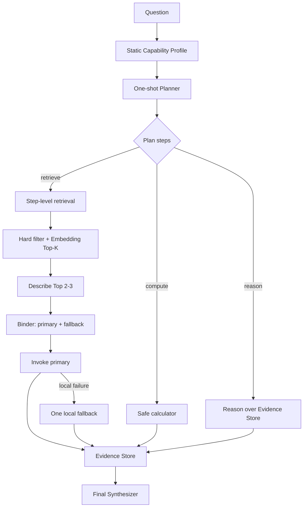

# PE-Fin Lite v1 — Method Card

**Working name:** PE-Fin Lite v1  
**Condition:** `pe_fin_lite`  
**Architecture identity:** `plan_first_step_level_retrieval_v1`

## Pipeline (Mermaid)

## Why simplify from APV-Fin

APV-Fin Diagnostic-12 final offline audit (`docs/apv_fin_diagnostic12_final_audit_v1/`) showed:

| Signal | Evidence |
|---|---|
| Strict answer success | **0/12** |
| Resource-limit failures | 8/12 |
| Incomplete disclosure chain | primary taxonomy 8/12 |
| Required outputs satisfied | 4/12 |
| Final contract valid | 1/12 |
| Mean LLM calls | 5 (high control cost vs yield) |

Research conclusions: better capability-aware selection did not convert into answer correctness; Plan/Monitor/Verify/Final control cost was high relative to yield; the system behaved like an over-engineered controller on this slice.

PE-Fin Lite is the deliberate **less-is-more** follow-on: keep Plan-and-Execute flexibility, delete the failing complexity.

## Kept

- Plan-and-Execute flexibility (semantic DAG steps)
- Static capability profile (swappable; not an LLM compiler)
- Step-level embedding retrieval (Top-K=5) + describe Top 2–3
- Tool Binder with **primary + fallback in one call**
- UnifiedRealMcpGateway + find/describe/invoke
- Deterministic Evidence Store + safe calculator
- Fixed HKEX disclosure composite (`list→download→parse→keyword→pages`)
- Shared FINAL_ANSWER_CONTRACT + evaluator v1.2
- Fail-closed budgets, resume identity, dry/mock/live isolation

## Deleted (vs APV-Fin)

- Global Monitor loop / per-step Monitor LLM
- Repeated global Replanner / exceptional replan rounds
- Capability requirement compiler + large capability ontology
- Tier A/B/C multi-stage ranking
- Runtime state patch protocol
- Deterministic progressor + Monitor dual controller
- Multi-round self-reflection / unlimited repair
- Task-specific workflow patches / evidence requirement compiler

## Allowed recovery only

1. Planner JSON: 1 + at most 1 repair  
2. Binder: primary + fallback in the **same** response (no binder repair loop)  
3. Retrieve: at most **one** local fallback  
4. Final JSON: 1 + at most 1 repair  

## Why embedding is per retrieve step

A single whole-question retrieval collapses multi-domain plans into one ranking and loses step objectives (entity/period/required_outputs). PE-Fin Lite builds a **step search query** from objective/domain/entity/period/date/required_outputs, then hard-filters and embeds at that step. This preserves plan flexibility without APV’s compiler/Monitor.

## Required-output success

A retrieve step is completed only when:

`execution_ok AND missing_outputs == [] AND scope_match == true`

MCP HTTP/transport success with missing required outputs is **not** step completion.

## Local fallback boundary

Fallback runs only for: transport/protocol failure, invalid/empty result, missing required outputs, or entity/period/date/basis scope mismatch. At most once per retrieve step. No global replan.

## HK-155 → ETOM migration boundary

| Layer | HK-155 | ETOM (future) |
|---|---|---|
| Core method | unchanged | unchanged |
| Capability profile | `hk155_capability_profile_v1.yaml` | ETOM profile |
| Registry adapter | HK 39 runtime ops + metadata | ETOM 2375 tools registry/index |
| Dataset/evaluator | HK-155 answer evaluator v1.2 | ETOM route evaluator |

## Contrast vs baselines

| Method | Control | Retrieval | Notes |
|---|---|---|---|
| Operation-Visible | free multi-turn | describe/invoke | Stronger than APV on Diagnostic-12 descriptive correct (2/12) |
| Flat | single-pass tools | all tools visible | Low LLM, weak tool discipline |
| MCP-Zero | ATR-style | embedding | Separate protocol; not copied |
| APV-Fin | Monitor+Replan+Compiler | capability tiers | 0/12 strict on Diagnostic-12 |
| **PE-Fin Lite** | plan-once + step execute | per-step Top-K + primary/fallback | Less controller, same gateway/evaluator |

## Budgets (fail-closed)

- max plan steps: 6  
- max total LLM calls / task: 8  
- max MCP invocations / task: 8  
- max local fallback / retrieve: 1  
- no Monitor calls; no global replan rounds  
